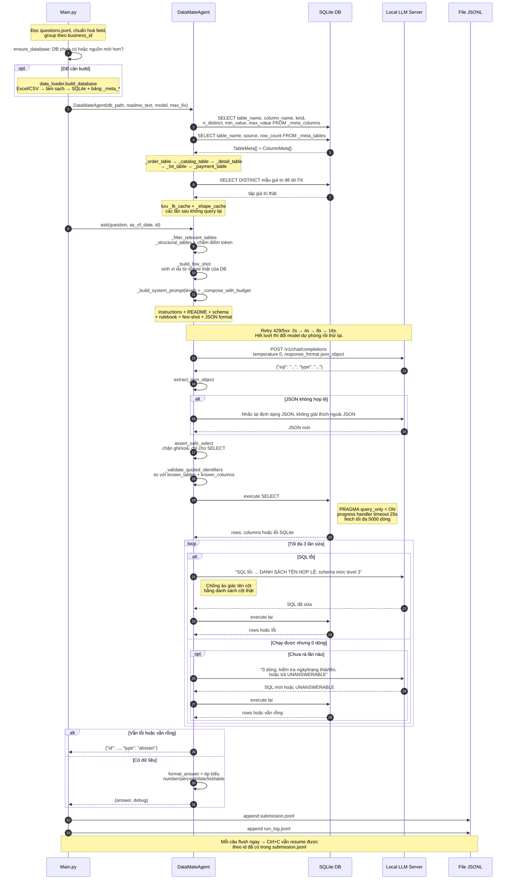

# Kiến trúc DataMate — Workflow chi tiết

Tài liệu này mô tả luồng chạy thật của 3 file: `data_loader.py`, `agent.py`, `main.py`.
Toàn bộ tên hàm ghi trong biểu đồ đều tồn tại trong mã nguồn.

---

## BIỂU ĐỒ 1 — FLOWCHART: luồng dữ liệu tổng thể

```mermaid
flowchart TD
    %% ================= ĐIỀU PHỐI =================
    M0["main.py<br/>read_jsonl + normalise_question<br/>group_by_business"]
    M1{"DB của biz<br/>đã có và còn mới?"}
    M2["ensure_database<br/>gọi data_loader.build_database"]
    M3["DataMateAgent(db_path, readme_text,<br/>model, max_fix=3, prompt_budget)"]
    M4["ThreadPoolExecutor workers<br/>ask(question, as_of_date, id)"]

    M0 --> M1
    M1 -->|"chưa có, dữ liệu mới hơn, hoặc chọn rebuild"| M2
    M1 -->|"rồi, hoặc chọn skip-build"| M3
    M2 --> M3
    M3 --> M4

    %% ================= ① INGESTION =================
    subgraph ING["① DATA INGESTION — data_loader.py"]
        direction TB
        A0["data/biz_XXX/<br/>.xlsx · .xls · .csv · .sqlite<br/>+ README.md"]
        A1["_collect_slices<br/>quét file, đọc mọi sheet"]
        A2["detect_header_row<br/>dò dòng tiêu đề thật"]
        A3["_build_columns + slug<br/>cột về snake_case ASCII<br/>giữ tên gốc trong _meta_columns"]
        A4["clean_series<br/>tiền → int VND<br/>ngày → YYYY-MM-DD<br/>số → float"]
        A5["_drop_junk_rows<br/>bỏ dòng tổng, dòng ghi chú"]
        A6["_drop_header_echo<br/>bỏ dòng lặp lại tiêu đề"]
        A7["_fill_blanks_within_group<br/>điền ô trống theo mã đơn"]
        A8["_group_slices<br/>gộp sheet/file cùng bộ cột"]
        A9["ghi SQLite<br/>1 file DB cho mỗi doanh nghiệp"]
        A10[("_meta_tables · _meta_columns<br/>_meta_info · _quy_doi · _meta_readme")]

        A0 --> A1 --> A2 --> A3 --> A4 --> A5 --> A6 --> A7 --> A8 --> A9 --> A10
    end

    %% ================= ② DISCOVERY =================
    subgraph DISC["② SCHEMA DISCOVERY — agent.py, schema-agnostic"]
        direction TB
        B0["_load_metadata<br/>đọc _meta_columns + _meta_tables"]
        B1["_order_table<br/>cột NGÀY + cột TIỀN"]
        B2["_catalog_table<br/>cột MÃ + cột TÊN"]
        B3["_detail_table<br/>TIỀN + FK tới mã đơn"]
        B4["_lot_table<br/>cột HẠN DÙNG + FK sản phẩm"]
        B5["_payment_table<br/>TIỀN + FK đơn + ngày thu"]
        B6["_structural_tables<br/>bộ bảng cấu trúc của biz này"]
        B7["_fk_overlap<br/>giao tập giá trị thật, LIMIT 200<br/>cache trong _fk_cache"]

        B0 --> B1 --> B2 --> B3 --> B4 --> B5 --> B6
        B3 -.-> B7
        B5 -.-> B7

        N1["📌 CHỐNG ẢO GIÁC SCHEMA<br/>Chỉ dùng: vai trò cột + giao giá trị thật + từ vựng nghiệp vụ.<br/>Không có tên bảng nào bị viết cứng trong logic."]:::note
        N2["📌 VÌ SAO CẦN VALUE OVERLAP?<br/>biz_124 nối order_id với ma_giao_dich,<br/>khớp theo tên sẽ thất bại."]:::note

        B1 --- N1
        B7 -.-> N2
    end

    A10 --> B0
    M3 --> B0

    %% ================= ③ LINKING =================
    subgraph LINK["③ SCHEMA LINKING — _filter_relevant_tables()"]
        direction TB
        C0["câu hỏi → strip_diacritics → tokens"]
        C1["chấm điểm từng bảng và cột<br/>khớp token + ưu tiên cột tiền/ngày"]
        C2["hợp với _structural_tables<br/>luôn giữ đơn · danh mục · chi tiết · lô · thanh toán"]
        C3["giới hạn còn min 8 bảng, base 6"]

        C0 --> C1 --> C2 --> C3
    end

    B6 --> C2
    M4 --> C0

    %% ================= ④ FEW-SHOT =================
    subgraph FEW["④ DYNAMIC FEW-SHOT — _build_few_shot()"]
        direction TB
        D0["đọc các shape đã phát hiện"]
        D1{"có bảng chi tiết<br/>và bảng danh mục?"}
        D2["mẫu JOIN 3 bảng<br/>SUM tiền trên bảng chi tiết"]
        D3["mẫu bảng phẳng<br/>LIKE trên cột tên ngay bảng chính"]
        D4["mẫu lô hạn dùng<br/>JOIN danh mục + ORDER BY hạn dùng"]
        D5["mẫu công nợ<br/>cột còn nợ, hoặc tổng mua trừ tổng trả"]
        D6["mẫu đếm đơn + doanh thu tháng<br/>ngày có giờ thì dùng LIKE YYYY-MM-DD%"]

        D0 --> D1
        D1 -->|"có"| D2
        D1 -->|"không"| D3
        D0 --> D4
        D0 --> D5
        D0 --> D6
    end

    C3 --> D0

    %% ================= ⑤ PROMPT =================
    subgraph PROMPT["⑤ PROMPT ASSEMBLY — _build_system_prompt(level)"]
        direction TB
        E0["_instructions<br/>9 quy tắc sinh tử"]
        E1["README nghiệp vụ của chính biz"]
        E2["schema text<br/>bảng, cột, kiểu, DISTINCT, min/max"]
        E3["khoảng ngày có dữ liệu + quy đổi đơn vị"]
        E4["rulebook chọn theo câu hỏi"]
        E5["dynamic few-shot"]
        E6["khối JSON format ở cuối prompt"]
        E7{"vượt ngân sách token?"}
        E8["hạ cấp L0 → L1 → L2 → L3<br/>bớt DISTINCT, bớt rulebook, rút README"]

        E0 --> E1 --> E2 --> E3 --> E4 --> E5 --> E6 --> E7
        E7 -->|"có"| E8
        E8 -->|"thử lại"| E7
        E7 -->|"không"| F0
    end

    D6 --> E0

    %% ================= ⑥ INFERENCE =================
    subgraph RUN["⑥ LLM INFERENCE & EXECUTION"]
        direction TB
        F0["build_date_context<br/>hôm qua · tuần trước · tháng này · Tết"]
        F1["_call_llm → _request_llm<br/>rate limiter + backoff"]
        F2["POST /v1/chat/completions<br/>temperature 0, json_object"]
        F3["extract_json_object<br/>bóc JSON ra khỏi text"]
        F4["assert_safe_select<br/>chặn INSERT/UPDATE/DELETE/PRAGMA"]
        F5["_validate_quoted_identifiers<br/>chặn tên cột không tồn tại"]
        F6["_execute_sql<br/>PRAGMA query_only + timeout 25s"]

        F0 --> F1 --> F2 --> F3 --> F4 --> F5 --> F6

        N3["📌 FALLBACK MODEL<br/>429/5xx → backoff 2s, 4s, 8s, 16s<br/>hết lượt → đổi model dự phòng rồi thử lại"]:::note
        N4["📌 PROMPT_TOO_LARGE<br/>lỗi 413 → hạ level prompt rồi gọi lại"]:::note

        F1 -.-> N3
        F1 -.-> N4
    end

    %% ================= ⑦ SELF-CORRECTION =================
    subgraph FIX["⑦ SELF-CORRECTION LOOP — tối đa 3 lần"]
        direction TB
        G1{"SQL lỗi?"}
        G2["gửi lại lỗi + DANH SÁCH CỘT HỢP LỆ<br/>schema mức level 3"]
        G3{"kết quả 0 dòng?"}
        G4["rà lại đúng 1 lần<br/>nhắc kiểm tra ngày, trạng thái, tên hàng"]
        G5["abstain<br/>không đủ dữ liệu"]

        G1 -->|"có, còn lượt"| G2
        G1 -->|"quá 3 lần"| G5
        G1 -->|"không"| G3
        G3 -->|"có, chưa rà"| G4
        G3 -->|"vẫn rỗng"| G5
        G2 -->|"sửa SQL"| F2
        G4 -->|"sửa SQL"| F2
    end

    F6 --> G1
    G3 -->|"có dữ liệu"| H0

    %% ================= ⑧ OUTPUT =================
    subgraph OUT["⑧ OUTPUT & LOGGING — main.py"]
        direction TB
        H0["format_answer<br/>ép kiểu theo type"]
        H1{"type là gì?"}
        H2["number · percent · date<br/>string · boolean"]
        H3["list 1 chiều<br/>top k, danh sách, từng tháng"]
        H4["table<br/>khi câu hỏi cần từ 2 cột"]
        H5[/"submission.jsonl<br/>flush sau mỗi câu, resume theo id"/]
        H6[/"run_log.jsonl<br/>SQL, lỗi, số lần sửa, token, thời gian"/]

        H0 --> H1
        H1 --> H2
        H1 --> H3
        H1 --> H4
        H2 --> H5
        H3 --> H5
        H4 --> H5
        H5 --> H6
    end

    G5 --> H0

    classDef note fill:#fff7d6,stroke:#d4a017,stroke-dasharray:4 3,color:#5a4200,text-align:left
    classDef db fill:#e7f6ec,stroke:#2f8f4e
    class A10 db
```

---

## BIỂU ĐỒ 2 — SEQUENCE: tương tác giữa các thành phần

---

## Ghi chú kiến trúc

| Thành phần | File | Vai trò |
|---|---|---|
| Ingestion | `data_loader.py` | Làm sạch, gộp sheet, ghi SQLite + bảng metadata |
| Discovery | `agent.py` | Nhận diện bảng đơn / danh mục / chi tiết / lô / thanh toán |
| Linking | `agent.py` | Lọc bảng theo câu hỏi, luôn giữ bảng cấu trúc |
| Few-shot | `agent.py` | Sinh ví dụ từ schema thật, không có tên bảng cứng |
| Prompt | `agent.py` | Ghép 7 khối, tự hạ cấp L0→L3 khi vượt ngân sách |
| Execution | `agent.py` | LLM → SQL → SQLite, chặn ghi, timeout 25s |
| Self-correction | `agent.py` | Sửa SQL tối đa 3 lần, rà rỗng 1 lần |
| Output | `main.py` | Ghi `submission.jsonl` + `run_log.jsonl`, resume theo `id` |

**Bất biến quan trọng**

1. Một câu hỏi chỉ chạy trên DB của đúng `business_id` của nó.
2. Không có câu SQL nào ghi được vào DB (`PRAGMA query_only`).
3. Mọi tên bảng/cột trong SQL phải nằm trong `known_tables` / `known_columns`.
4. Mọi lỗi đều được nuốt trong `ask()` → luôn trả về một dict, không làm sập batch.
5. `submission.jsonl` được flush sau từng câu → chạy lại sẽ bỏ qua câu đã có.
